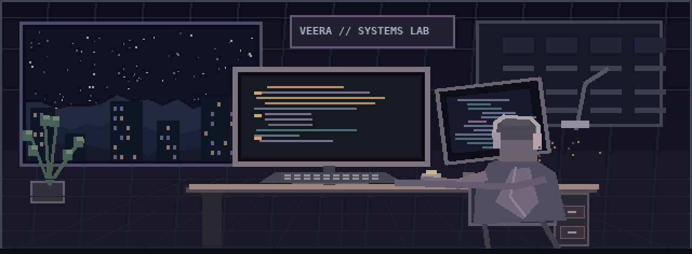
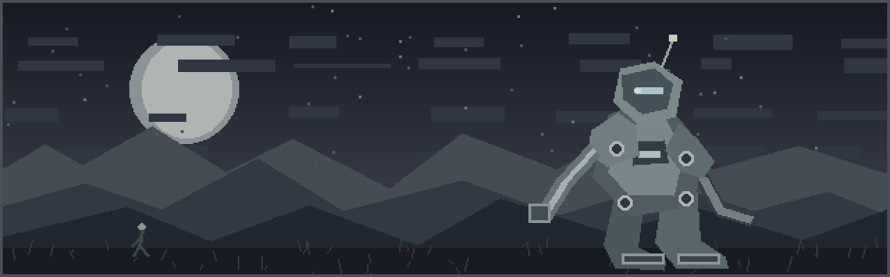
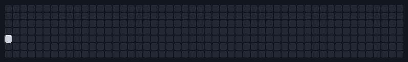

 

# v e e r a &nbsp; m .

**full-stack development · machine learning · secure systems**

computer science @ vit chennai &nbsp; / &nbsp; building things that feel useful, thoughtful, and fast

  

---

### a b o u t

I build **intelligent applications, local-first tools, and interfaces** where engineering details matter.  
My interests sit between **full-stack development, computer vision, and privacy-conscious software**.

B.Tech Computer Science and Engineering · **VIT Chennai** · Class of **2028**

 

### n o w

Exploring **secure, offline-first applications** through **Aethelgard**.  
Working on **PlacementIQ**, a collaborative AI-powered placement-readiness and interview platform.  
Experimenting with **machine learning, computer vision, and thoughtful product design**.

---

---

### s t a c k

**languages**

**building**

**machine learning & tools**

---

### m e t r i c s

<!-- These cards show live public GitHub data through third-party services. -->

Live stat images are provided by third parties and can temporarily be unavailable.

 

Below is a custom animated activity simulation inspired by the reference design — it is not GitHub's real contribution heatmap.

---

### s t u f f &nbsp; i &nbsp; m a d e

**[Aureus — AI-assisted finance](https://github.com/VeeraM-SYS/Aureus-AI-Assisted-Financial-Management)**  
A personal finance application with interactive dashboards, adaptive budgeting, and AI-assisted insights.

**Aethelgard — local-first personal OS**  
A private, offline-first mobile/web workspace built with React, Capacitor, IndexedDB, and on-device encryption.

**PlacementIQ — intelligent placement readiness**  
A collaborative project combining baseline ML assessment, AI interview workflows, and personalized career preparation.

**Real-time object & animal recognition**  
Computer vision experiments with TensorFlow CNNs, YOLO, and OpenCV. Reported CNN classification accuracy: **83.4%**.

 

**other public code**  
[Film Club Website](https://github.com/VeeraM-SYS/Film-Club-Website) · [silent-signals](https://github.com/VeeraM-SYS/silent-signals) · [Thamizhagam](https://github.com/VeeraM-SYS/Thamizhagam)

---

### c o n n e c t

built with curiosity, shipped one commit at a time.

